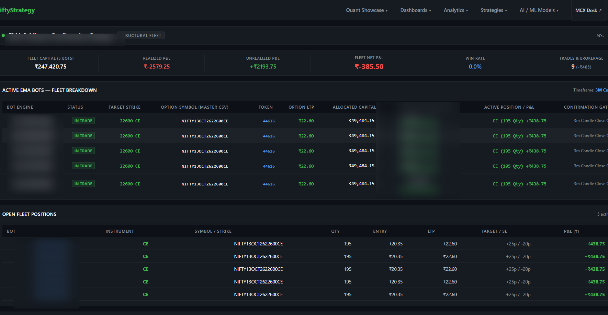
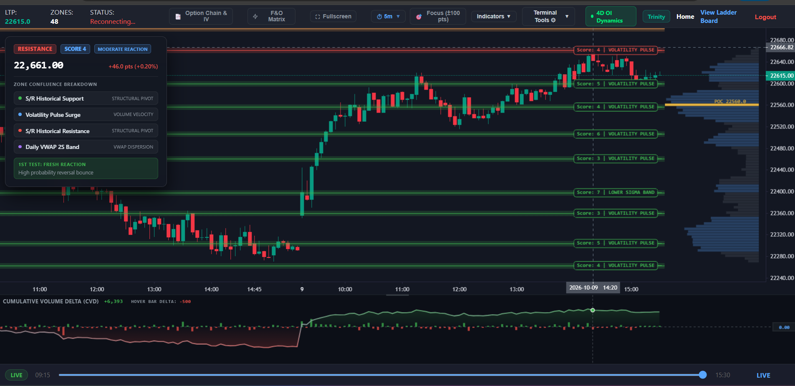

# SigmaQuant Platform

High-Throughput Quantitative Execution, Derivatives Risk Infrastructure & Strategy Telemetry

Website: https://sigmaquant.space  
Author: Partho Baruah  
Contact: partho550@gmail.com  

---

## 1. Overview

SigmaQuant is a distributed quantitative execution and derivatives risk platform architected for National Stock Exchange (NSE) equities and index derivatives. The platform provides automated quote ingestion, real-time contract resolution across 38,000+ active derivative instruments, portfolio Greek risk containment, and deterministic process lifecycle supervision across multi-host environments.

The system is designed to decouple market data ingestion, pricing derivation, risk management, and order routing into modular services, ensuring minimal execution latency and continuous fault isolation during peak market volatility.

---

## 2. High-Level Architecture

The platform follows a decoupled, event-driven architecture designed to process quote updates while enforcing pre-trade risk controls and deterministic state recovery.

```
[ NSE Market Data Feeds / TBT ]
               │
               ▼
   [ Market Data Ingestion ]
   (AsyncIO Token Polling / 50-Token Multiplexing)
               │
               ▼
     [ In-Memory Cache ] <───> [ Contract Resolution Engine ]
     (Redis Pub/Sub & Key-Value)   (38,000+ Active NSE Master Book)
               │
               ├─────────────────────────┐
               ▼                         ▼
   [ Option Pricing Engine ]   [ Risk Management System (RMS) ]
   (Theoreticals, IV, Greeks)   (Delta, Vega, Gamma, Margin Limits)
               │                         │
               └───────────┬─────────────┘
                           ▼
              [ Strategy Execution Daemons ]
                           │
                           ▼
           [ Trade Server / Execution Gateway ]
                           │
                           ▼
          [ Live Exchange / Dummy Simulator ]
```

---

## 3. Core Modules

### 3.1. Market Data Ingestion & Multiplexing
* Asynchronous quote ingestion layer built with Python (AsyncIO) batch-polling quote updates across 210 NSE F&O equities.
* Batch-sized token multiplexing (50 tokens per chunk every 3 seconds) adhering strictly to exchange and broker rate limits.
* Zero tick dropout design ensuring continuity across high-volatility sessions.

### 3.2. Contract Master & Instrument Resolution Engine
* Automated parser for the NSE contract master database comprising 38,000+ dynamic contracts daily.
* Dynamic strike resolution identifying At-The-Money (ATM), In-The-Money (ITM), and Out-Of-The-Money (OTM) strikes based on live spot movements.
* Automated lot size calculation, expiry tracking, and live contract P&L evaluation.

### 3.3. Risk Management & Greeks Telemetry (RMS)
* Real-time portfolio Greek tracking across active desks (Delta, Gamma, Vega).
* Frontend and backend risk limit controls supporting both temporary intraday limit extensions and approved permanent limit pushes.
* Margin headroom telemetry calculating dynamic utilization against desk capital boundaries to prevent forced liquidation events.

### 3.4. Trading Stack Lifecycle & Multi-Host Process Orchestration
* Deterministic, dependency-ordered process bring-up and teardown sequence across dedicated servers:
  1. Market Data Feed Handler (TBT)
  2. Risk Management System (RMS)
  3. Trade Server / Execution Gateway (TS) or Dummy Exchange Simulator
  4. Option Pricing Engine (Pricer)
  5. Strategy Execution Daemons (Strategy)
* Post-market orphan process identification and termination, preventing dangling socket connections and ensuring clean system state for next-day cold start.

### 3.5. Idempotent State Persistence
* Dual-tier state storage backed by Redis (in-memory caching and messaging) and SQLite/relational storage for persistence.
* Deterministic state rehydration enabling strategy daemons to resume execution and open positions safely following system restarts.

---

## 4. Platform Interface & Telemetry

### 4.1. Strategy Execution Terminal
The execution terminal monitors active strategy daemons, real-time order lifecycle status, execution latencies, and service connectivity.



### 4.2. Market Regime & Zone Mapper
The zone mapper evaluates underlying market structure, dynamic volatility expansion zones, and trend confirmation parameters.



---

## 5. Technology Stack

* Core Runtime: Python 3.10+, Asynchronous Event Loops (AsyncIO)
* Web Framework & Sockets: Django, Daphne (ASGI), WebSockets
* In-Memory Caching & State: Redis (Key-Value, Pub/Sub)
* Persistence: SQLite / PostgreSQL
* Systems & Hosting: Linux (Ubuntu/Debian), Docker Containerization, AWS EC2
* Telemetry & Monitoring: Nagios, Systemd Service Supervision, Slack Webhook Alerting
* Market Telemetry: National Stock Exchange (NSE F&O / Equity)

---

## 6. Intellectual Property & Production Isolation Notice

This public repository serves as an architectural overview, interface demonstration, and technical reference for the SigmaQuant platform.

Proprietary quantitative alpha models, mathematical parameter weights, private broker API credentials, and live execution gateways are isolated in private institutional repositories to protect intellectual property and production integrity.

---

## 7. Author

Partho Baruah  
Trade Support Engineer | Trading Systems & Risk Automation  
Portfolio: https://sigmaquant.space  
Email: partho550@gmail.com  
Location: Ahmedabad / Delhi, India
